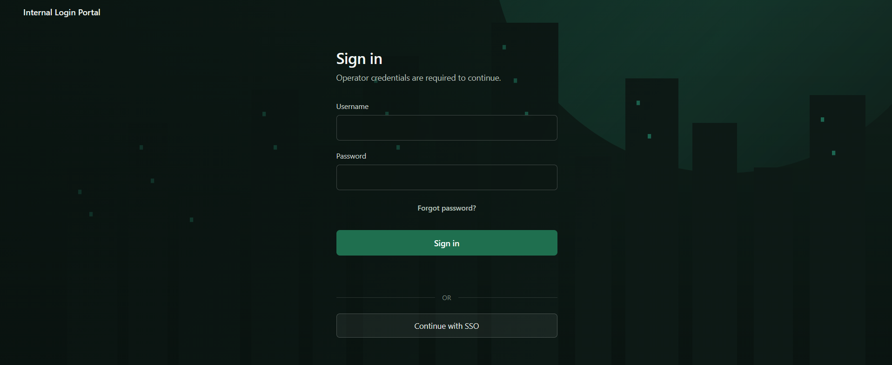
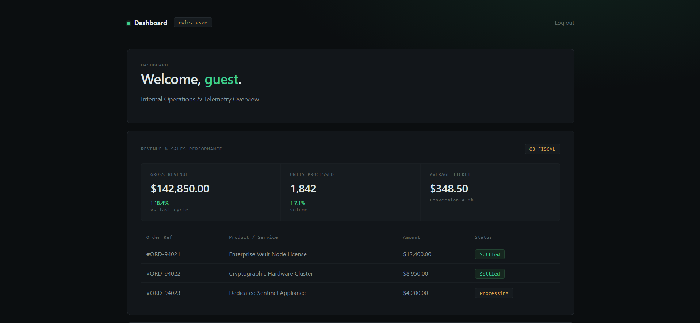
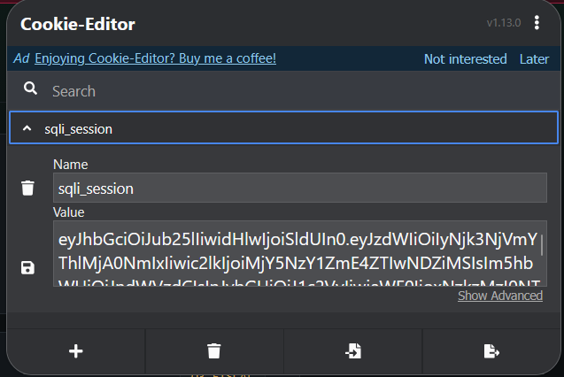
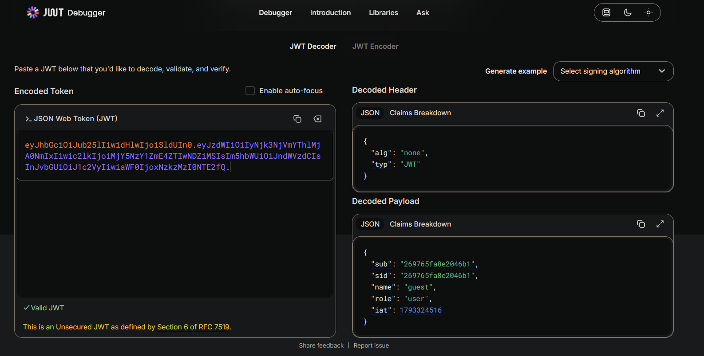
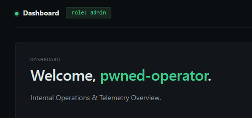
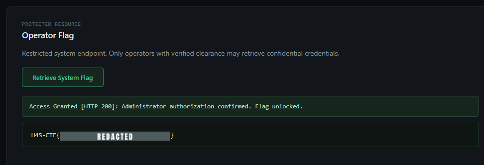

# Chained Reaction

- **Category:** Web Exploitation
- **Difficulty:** Hard

> Link: https://hack4shell-ctf.vercel.app/challenges

## Challenge Description


There was a login page with no signup option and no credentials given to log in. "Forgot password" and "Sign in with SSO" were present but non-functional (dead links/no backend action).




## Recon

Before touching the login form, I checked the page source and network requests for any hints. Nothing obvious, so the login form itself became the primary attack surface. Since there was no account creation path, the challenge clearly expected either:

1. An authentication bypass to get *any* session, and
2. A privilege escalation path from that low-privileged session to an admin/operator account.

## Step 1: SQL Injection in the Username Field

Tested the username field for classic SQLi behavior (error-based responses, boolean differences).

### Payload

```
OR 1=1'--
```

This logged in successfully — but as a **guest** account, not admin. This confirmed the backend was building a raw SQL query like:

```sql
SELECT * FROM users WHERE username = '<input>' AND password = '<input>'
```

and the injected `OR 1=1'--` short-circuited the WHERE clause, returning the first row in the table (guest) and commenting out the rest of the query, including the password check.




At this point I checked the hint provided for the challenge, which nudged toward inspecting the session token — suggesting the privilege escalation was meant to happen *after* authentication, not during it.

## Step 2: JWT Analysis and Manipulation

Inspected the session cookie/token issued after login — it was a JWT. Decoded it using [jwt.io](https://jwt.io).

### Findings




The payload contained two attacker-controllable-looking claims:

```json
{
  "username": "guest",
  "role": "user"
}
```

The header specified `alg: HS256`, but there was no indication the signature was actually being verified server-side with a secret the way it should have been. So the next move was to simply tamper with the claims and see if the server trusted them without re-validating the signature.




### Changes Made

```diff
- "username": "guest"
+ "username": "pwned-operator"

- "role": "user"
+ "role": "admin"
```

Re-encoded the token (using the `none`/unverified approach, since no valid secret was known) and swapped it into the session cookie.




## Step 3: Privileged Request

With the tampered JWT set, I requested the operator-only endpoint that was previously returning `401/403`:

```
GET /api/operator/flag
```

**Response:** `200 OK` — the endpoint returned the flag.




## Root Cause

Two independent vulnerabilities were chained together:

1. **SQL Injection (Authentication Bypass):** User input was concatenated directly into the SQL query without parameterization, allowing login as an arbitrary existing user via `OR 1=1'--`.
2. **Broken JWT Verification (Privilege Escalation):** The server decoded and trusted the JWT payload (`username`, `role`) without properly verifying the signature, allowing any authenticated (even guest-level) user to escalate to `admin`/`operator` simply by editing the token client-side.


## Key Takeaways

- **Never build SQL queries via string concatenation.** 
- **Always verify JWT signatures server-side**
- **Don't trust client-suppliable claims for authorization.** 
- **Chained low-severity bugs can equal a critical.** 


